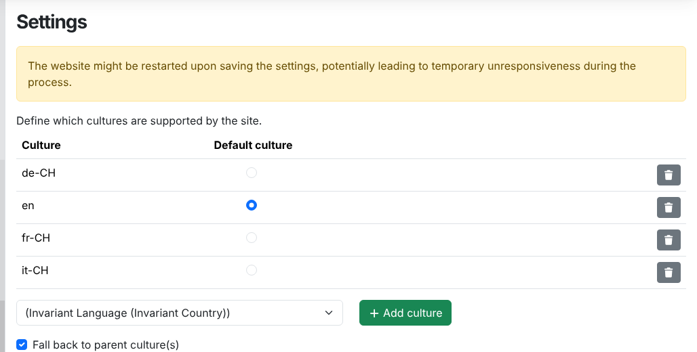

# Installation guide — Supertext Translation for Orchard Core

For administrators who install and configure the module.

## Requirements

- Orchard Core **3.0** (tested with 3.0.1) on .NET 10.
- The Orchard Core features **Localization** and **Content Localization** (the module enables them as dependencies).
- A Supertext account with an API key for AI translation (see [API key](#api-key)).
- The server must reach `https://api.supertext.com` over HTTPS.

## Install

The module is a NuGet package (an Orchard Core module). It is not on nuget.org yet; until then, build it from this repository:

```bash
dotnet pack src/Supertext.OrchardCore.Translation -c Release -o ./packages
```

Then, in your Orchard Core web project, add the package (from that folder as a package source) or reference the project directly:

```bash
dotnet add package Supertext.OrchardCore.Translation --source ./packages
# or
dotnet add reference path/to/src/Supertext.OrchardCore.Translation/Supertext.OrchardCore.Translation.csproj
```

Build and restart the site, then enable the feature on the **Features** page of the admin (`/Admin/Features`): search for **Supertext Translation** and click **Enable**. Orchard Core enables Content Localization along with it.

In a setup recipe, add `"Supertext.OrchardCore.Translation"` to the `feature` step.

## Update

Update the package version (or pull the repository), build and restart. Settings and translations are kept.

## Uninstall

Disable **Supertext Translation** on the **Features** page (`/Admin/Features`), then remove the package reference and rebuild. Translations already created stay as normal content items. The stored settings (in the site settings) stay too; they do no harm.

## API key

**Settings → Supertext** (`/Admin/Settings/supertext`; requires the *Manage Supertext settings* permission; administrators have it).

Get a key first:

- No Supertext account yet? [Log in or create a Supertext account](https://www.supertext.com/person/en/account/signin) with your e-mail address.
- Generate the AI API key at [supertext.com → Integrations → API](https://www.supertext.com/en/integrations/api). This requires the **Admin** role in your Supertext account.

The settings page shows both links below the API key field.

1. Paste the API key. A key copied with its `Supertext-Auth-Key` prefix works too.
2. Click **Save**. The module checks the key with Supertext (free of charge, nothing is translated) and shows the result: *API key checked: the connection to Supertext works.*, *Supertext rejected the API key* (with the links to create an account and generate a key), *No API key is set yet*, *Supertext can't be reached* or *Supertext answered with an error*. An invalid key never blocks saving. The page keeps showing the latest result with its time under **API key check** (see [Version information and the API key check](#version-information-and-the-api-key-check)).


The bottom of the page shows the installed **Module version** (read from the module itself). For a release version it links to that release's notes on GitHub; quote it when you contact support.

The key is stored encrypted with ASP.NET Core data protection. It is never shown again; leave the field empty to keep it, or tick **Remove the stored API key**.

**Environment variables win** over the settings page (useful for containers):

| Variable | Configuration key | Meaning |
| --- | --- | --- |
| `SUPERTEXT_API_KEY` | `Supertext:ApiKey` (tenant configuration) | API key. The settings page then shows that the key comes from the environment. |
| `SUPERTEXT_API_ENDPOINT` | `Supertext:Endpoint` | API endpoint, default `https://api.supertext.com/v1/`. The endpoint field is then read-only. |
| `SUPERTEXT_VERSION_REPORTS` | – | `0` (or `false`, `off`, `no`) turns *Send version information to Supertext* off, `1` (`true`, `on`, `yes`) on, whatever the settings page says. The checkbox is then read-only. |

## Language setup

Translations go from an item's culture into the other cultures of the site. Set the cultures under **Settings → Localization → Cultures** (`/Admin/Settings/localization`): add each language and choose the default (source) culture.



Then make the content types you want to translate localizable: open the type on the **Content Types** page (`/Admin/ContentTypes/List`), click **Add Parts** and add **Localization**. Only types with the *Localization* part show the Supertext buttons.

Each culture needs a **Supertext language**. Supertext accepts exactly these target codes (from its `features` list, October 2026):

| Language | Supertext codes |
| --- | --- |
| German, English, French, Italian, Portuguese | `de-DE`, `de-CH`, `de-AT`, `en-US`, `en-GB`, `fr-FR`, `fr-CH`, `it-IT`, `it-CH`, `pt-PT`, `pt-BR` |
| Chinese, Serbian | `zh-Hans`, `zh-Hant`, `sr-Latn`, `sr-Cyrl` |
| Swiss German | `gsw-u-sd-chzh` (Zurich), `gsw-u-sd-chbe` (Bern) |
| All others, without region | `bg`, `cs`, `da`, `el`, `es`, `fi`, `hr`, `hu`, `ja`, `ko`, `nb`, `nl`, `pl`, `rm`, `ru`, `sk`, `sl`, `sq`, `sv`, `tr` |

**Settings → Supertext → Language mapping** has one row per culture of the site (the default culture included: one mapping serves both directions) with a select of Supertext's languages, named in your back-end language with the code next to them (*Deutsch (Schweiz) (de-CH)*). Each select is pre-selected:

1. with the language you saved for that culture, else
2. with the culture itself if its name **is** one of the codes above (apart from upper/lower case and `_`/`-`): `de-CH`, `fr-CH`, `it-CH`, `es`, else
3. with the usual default where one is obvious (marked *Suggested by Supertext*):

| Culture | Default |
| --- | --- |
| `de`, `en`, `fr`, `it`, `pt` | `de-DE`, `en-US`, `fr-FR`, `it-IT`, `pt-PT` |
| `zh`, `zh-CN`, `zh-SG` / `zh-TW`, `zh-HK`, `zh-MO` | `zh-Hans` / `zh-Hant` |
| `sr`, `sr-Latn-RS` / `sr-Cyrl-RS` | `sr-Latn` / `sr-Cyrl` |
| A region of a language without regions | the bare code: `es-ES`, `es-419` → `es`, `nl-NL` → `nl`, `sl-SI` → `sl`, `nb-NO` → `nb` |

Choose another language to change it (for example `de-CH` for `de`) and save. A culture you haven't saved translates with what the select shows. A culture with no obvious Supertext language (`en-IE`, `de-LI`, `fr-BE`, `sr-RS`, `gsw`, `no` …) shows *— choose —* and *Not mapped*; translating into or from it ends with *The language … has no Supertext language yet* (nothing is sent to Supertext) until you choose one. Only Supertext's codes can be saved.
- The source is sent as its language without region (`en-US` → `en`); a mapped culture is sent in its source form (`de` mapped to `de-CH` → `de`).
- The form of address (*Formal*/*Informal*) isn't offered by Supertext for English, Swiss German, Romansh, Albanian and Serbian. Those languages are translated in the default tone, and the language mapping says so next to them.

A URL per language comes from the type's Autoroute pattern. To give each culture its own prefix, use for example:

```liquid
{{ ContentItem.Content.LocalizationPart.Culture | slice: 0, 2 }}/{{ ContentItem | display_text | slugify }}
```

Translated items get their URL from the translated title when they are saved.

## Interface languages

The module's own screens (the *Supertext* buttons, the *Translate with Supertext* page, **Settings → Supertext**, the admin menu entry, notifications and error messages) are in English, German, French and Italian. They follow the admin's interface language, which Orchard Core takes from the site's supported cultures: the browser's preferred language, the language chosen with the **Admin Culture Picker** feature (a picker in the admin top bar), or the user's own culture with the **User Localization** feature. A regional culture (`de-CH`, `fr-CH`, `it-CH`) uses its language's texts; other languages fall back to English. Orchard Core shows permission names on the *Roles* page in English for every module, so *Translate content with Supertext* and *Manage Supertext settings* stay English there.

## Permissions

| Permission | Default roles | Allows |
| --- | --- | --- |
| Translate content with Supertext | Administrator, Editor | The *Supertext* buttons and the *Translate with Supertext* page, together with *Localize content* and *Edit content* on the item (the buttons only show when the user has all three). The same applies to *Export for translation* and *Import translation* on that page; importing into an existing language version also needs *Edit content* on it. |
| Manage Supertext settings | Administrator | **Settings → Supertext** |

Grant them on the **Roles** page (`/Admin/Roles/Index`).

**Export for translation / Import translation** (XLIFF 1.2 or HTML files, see the user guide) need nothing to configure and no API key: they don't call Supertext. Uploads are limited to 10 MB (larger requests are refused before the file is read) and are read in memory, never stored. A reverse proxy in front of the site must allow request bodies of at least 11 MB for imports (for example `client_max_body_size 11m;` in nginx).

## All settings

| Setting | Default | Meaning |
| --- | --- | --- |
| API key | – | See above. |
| API endpoint | `https://api.supertext.com/v1/` | Change only for testing. Must be `https` (plain `http` only to `localhost`), because the API key travels with every request. Read-only while `SUPERTEXT_API_ENDPOINT` is set. |
| Translate new localizations automatically | on | When an editor creates a culture version with Orchard Core's *Localizations* menu, the copy is translated before the editor opens it. Off: the copy stays in the source language; *Translate with Supertext* still works. |
| Form of address | As in the source | *Formal* or *Informal* for languages that distinguish them (German *Sie*/*du*, French *vous*/*tu* …). Languages Supertext offers no choice for (English, Swiss German, Romansh, Albanian, Serbian) are translated in the default tone. |
| Language mapping | the culture's Supertext code, else its default (`de` → `de-DE` …) | One select per culture of the site with the Supertext language it is translated into and from (see [Language setup](#language-setup)). Pre-selected with the saved choice, else the exact code, else the default; cultures without one (`en-IE`, `de-LI` …) must be chosen. Stored as `culture=code` lines in the site settings (mappings for cultures you removed are kept). Codes saved by older versions that Supertext doesn't accept are updated where the replacement is obvious (`es-ES` → `es`, `de` → `de-DE`). |
| Fields not to translate | – | One per line (or separated by commas): `Part.Field` (e.g. `Article.Subtitle`), a whole part (e.g. `HtmlBodyPart`) or `ContentType.Part.Field`. These keep the source text. |
| Timeout per language | 300 s | How long to wait for Supertext per language before giving up (30–3600 s). |
| Send version information to Supertext | on | See [Version information and the API key check](#version-information-and-the-api-key-check). `SUPERTEXT_VERSION_REPORTS` overrides it. |

## Version information and the API key check

**Send version information to Supertext** (**Settings → Supertext → Support**) is on by default. The module then sends the site URL and the versions of this module, Orchard Core and .NET to Supertext when you save the Supertext settings and after an update, so Supertext support can see which version you run. A report contains exactly:

- the site URL (**Settings → General → Base URL** if set, else the address the admin was opened on),
- the module's name (`OrchardCore-Supertext-Translation`) and version, the Orchard Core and .NET versions, the version of the bundled Supertext SDK,
- whether an API key is set, and the result of the API key check (status, time, HTTP status, Supertext's error code),
- the address of the ping endpoint (below).

**No content, no API key and no personal data are sent.** Reports go from the Orchard Core server, never from the browser; on admin pages they are sent after the page has been delivered. A report that fails is not retried for an hour and never slows down or breaks saving or translating. To turn it off, untick the setting and save, or set `SUPERTEXT_VERSION_REPORTS=0` and restart: nothing is sent at all then, and the ping endpoint answers 404.

**The API key check** runs whether or not version information is sent: every time you save Settings → Supertext; when a key from `SUPERTEXT_API_KEY` (or the configuration) is new or changed, the next time an administrator or editor opens a Supertext page (the key is compared by a fingerprint kept in the site settings, never the key itself); and when Supertext rejects the key during a translation. It's Supertext's cost-free `features` call. **Settings → Supertext** shows the latest result with its time under **API key check**.

**The ping endpoint** `GET <site>/supertext/ping?challenge=…` is public (no login) and answers only `{"ok":true,"plugin":"OrchardCore-Supertext-Translation","challenge":"…"}`, so Supertext can see that the site is reachable from the internet. It returns nothing else: no versions, no settings, no data, and it is never cached (`Cache-Control: no-store`). If a firewall or an authentication proxy protects the whole site, Supertext simply sees it as unreachable.

The module keeps its state (what was reported last, the latest key check) in the site settings document, next to the Supertext settings.

## Troubleshooting

| Message or problem | What to do |
| --- | --- |
| *No Supertext API key is configured* / *No Supertext API key is set yet* | Add the key under **Settings → Supertext**, or set `SUPERTEXT_API_KEY`. Generate one at [supertext.com → Integrations → API](https://www.supertext.com/en/integrations/api) (Admin role). |
| *Authentication failed. Please check the Supertext API key.* | The key is wrong or revoked. Paste it again, or generate a new one at [supertext.com → Integrations → API](https://www.supertext.com/en/integrations/api). |
| *The stored Supertext API key could not be decrypted* (log) | The data protection keys changed (e.g. a new container without `App_Data`). Enter the key again, and keep `App_Data` on persistent storage. |
| *The language … has no Supertext language yet* / *Not mapped* in the language mapping | The culture is neither a Supertext code nor has a default (e.g. `en-IE`, `de-LI`, `gsw`). Choose its Supertext language in its select under **Settings → Supertext → Language mapping** (see [Language setup](#language-setup)). |
| *Supertext doesn't offer the code …* in the language mapping | An older mapping uses a code Supertext rejects and that has no obvious replacement. Choose a language from the list and save. |
| *Supertext does not support this language pair (en → xx-YY)* | The mapped code isn't one Supertext offers, or source and target are the same language. Fix the language mapping; the message shows the codes that were sent. |
| *Supertext offers no formal or informal tone for this language* | A mapped code the module doesn't know yet was sent with a form of address Supertext doesn't offer for it. Set **Form of address** to *As in the source*. |
| *Supertext rejected the API key* (API key check) | The key is wrong or revoked. Check that the whole key was copied, or generate a new one at [supertext.com → Integrations → API](https://www.supertext.com/en/integrations/api) (Admin role required). No Supertext account yet? [Create one](https://www.supertext.com/person/en/account/signin). Save the settings again to re-check. |
| *The API key couldn't be checked because Supertext can't be reached* | The server can't reach `api.supertext.com` (firewall, proxy, DNS). Translations need the same connection. |
| *The API key couldn't be checked: Supertext answered with an error (…)* | Usually temporary; save again later. If it persists, contact Supertext with the status shown. |
| *Too many requests to Supertext* | The module already retries rate limits 4 times; try again in a minute. |
| *Timed out waiting for the Supertext translation* | Very long items: raise the timeout. |
| *Your Supertext translation limit is exceeded* | Contact Supertext about your plan. |
| No *Supertext* button | The type has no *Localization* part, the item isn't saved yet, or the user lacks *Translate content with Supertext*. |
| *The site has only one culture* | Add cultures (see Language setup). |
| A field stays in the source language | It's excluded, it's not prose (URL, e-mail, number, code editor, color …), or the field type isn't supported (see the user guide). |

The module logs warnings under the category `Supertext.OrchardCore.Translation`.
