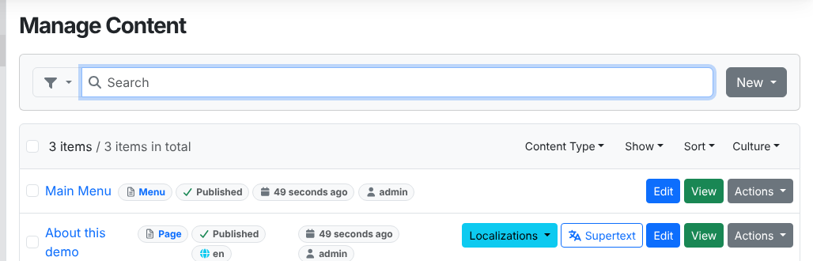
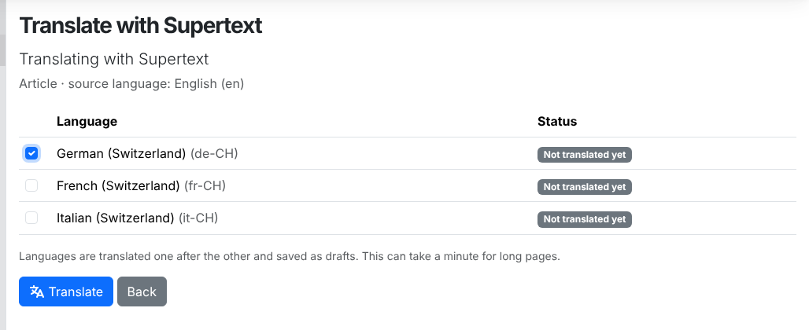
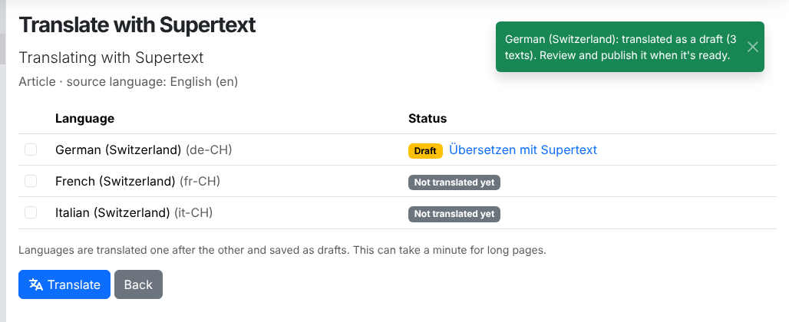
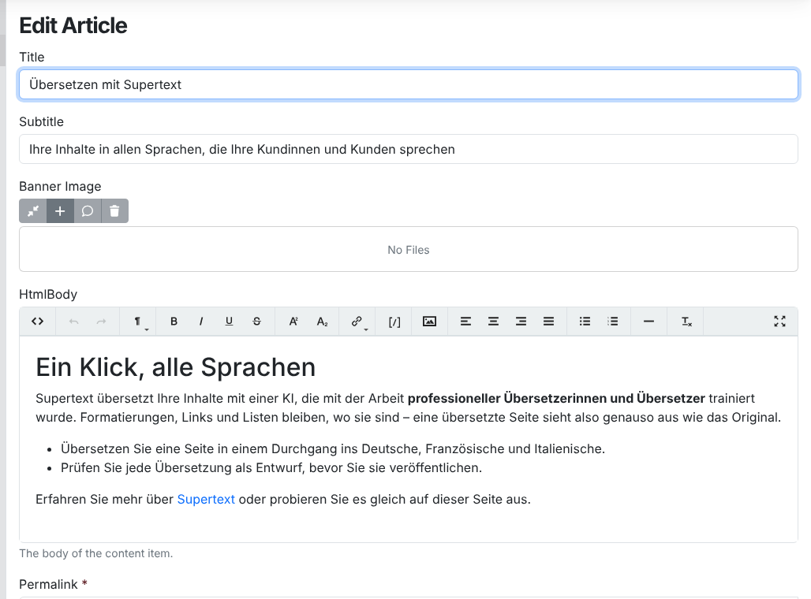
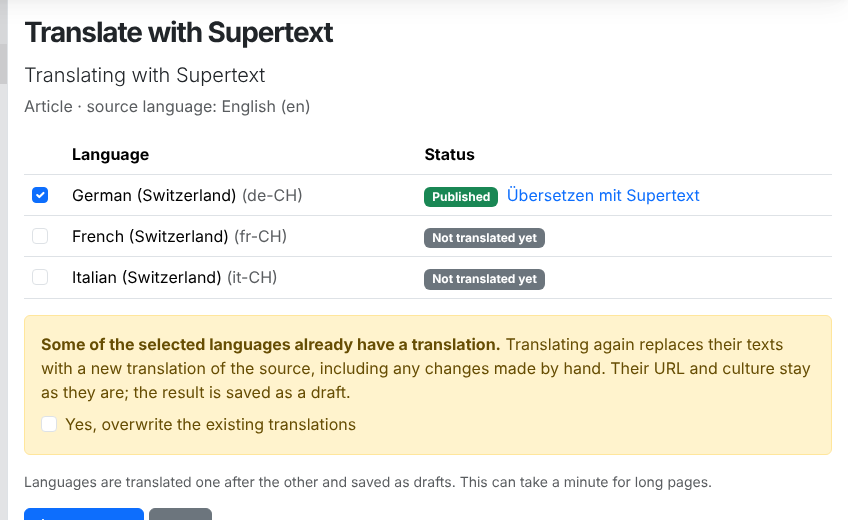
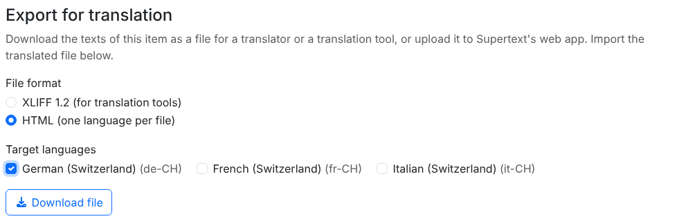
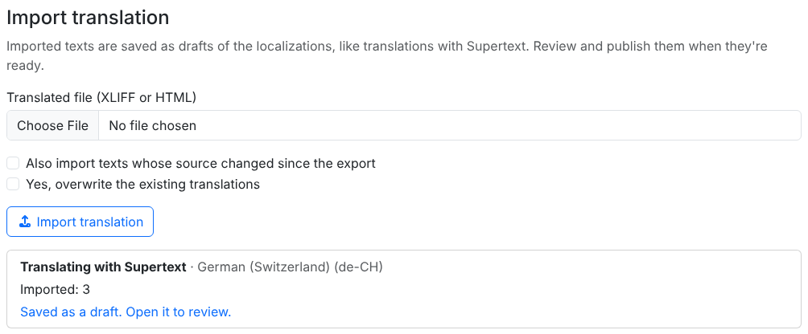
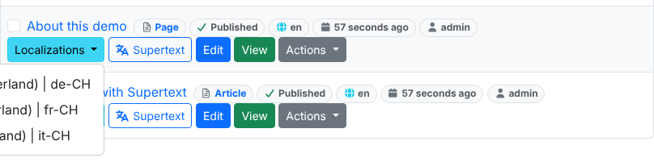
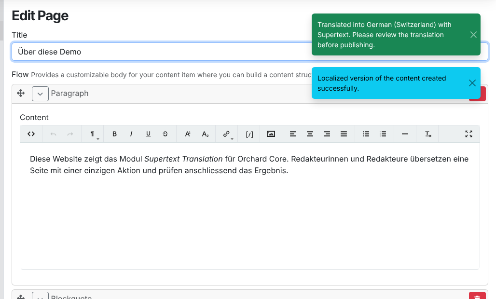

# User guide — Supertext Translation for Orchard Core

For editors who translate content. Your site has one source language (for example English) and some target languages (for example German, French and Italian). Each language version of a page is its own content item, linked to the others as *localizations*.

The Supertext buttons, the *Translate with Supertext* page and the messages follow the admin's interface language (English, German, French or Italian). The screenshots show the English interface.

## Translate a page

1. Open **Content → Content Items**. Pages that can be translated have a **Supertext** button (next to *Localizations*). In the editor, the same action is **Translate with Supertext** at the bottom.

   

2. Tick the languages you want and click **Translate**.

   

3. Supertext translates one language after the other. Each one is saved as a **draft**, and the page shows the result and a link to each translation.

   

The saved version of the source is translated. If you have unsaved changes in the editor, save first.

## Review and publish

Click the link of a translation (or open it from the content list's *Localizations* menu). Check the texts, change what you like, then click **Publish**. The URL is created from the translated title when you save.

## Translate again

If a language already has a translation, Supertext asks first:

Translating again **replaces the texts** of that translation with a new translation of the source, including any corrections you made by hand. The URL and language stay. The result is a new draft, so the published version stays online until you publish.

## Export for translation and import a translated file

Instead of translating with Supertext's AI right away, you can download the texts of an item as a file, have it translated elsewhere (by a translator, in a translation tool such as Trados, memoQ or Phrase, or in Supertext's web app) and import the translated file again. Both are at the bottom of the **Translate with Supertext** page.

**Export:**

1. Under **Export for translation**, choose the **File format**:
   - **XLIFF 1.2 (for translation tools)**: the standard format of translation tools. Formatting appears as protected tags, so translators can't break it. One file can hold several languages. This is the better choice for translation tools and agencies.
   - **HTML (one language per file)**: a web page with the texts, for Supertext's web app or anyone who translates HTML. Translators must leave the page's head (the `supertext:` lines) and the `data-st-id` attributes alone.
2. Tick the **Target languages** (for HTML exactly one) and click **Download file**. The file is called, for example, `orchardcore-<item id>-de-CH.xlf`.

   

3. Send the file to your translator or upload it to Supertext's web app. The saved version of the item is exported, as for translating.

**Import:**

1. Open the **Translate with Supertext** page of the same item (any item works: the file says which item and language it belongs to).
2. Under **Import translation**, choose the translated file. If the language already has a translation, tick **Yes, overwrite the existing translations**, as when translating again.
3. Click **Import translation**. The texts are saved as a **draft** of the language version (created if it doesn't exist yet), with the same rules as a translation with Supertext. Review and publish it.

   

The summary shows, per language:

| Line | Meaning |
| --- | --- |
| *Imported: 3* | Texts written into the draft. |
| *Skipped, source changed since the export: 1* | The source text was edited after the export, so the translation may be outdated. Tick **Also import texts whose source changed since the export** to import them anyway. |
| *Not translated in the file: 1* | The file has no translation for these texts (an empty target in XLIFF). |
| *Formatting changed, not imported: 1* | The translation broke or added formatting (tags, links). Fix it in the file and import again. |
| *Not in the file: 1* | Texts added to the item after the export. |

Texts that aren't imported stay in the source language in the draft, as when Supertext returns a text damaged. An HTML file imported unchanged writes the source text back: HTML can't mark a text as untranslated, so import only files that were translated.

Errors with the whole file: *This file isn't a valid XLIFF or HTML translation file*; *This file wasn't exported by the Supertext module, or its header was removed* (the `supertext:` head lines or the XLIFF header are missing); *The file is too large (at most 10 MB)*; *This file belongs to another system (…)* (exported by another Supertext plugin); *The content item this file was exported from no longer exists*; *The site has no language …*.

## Orchard Core's own Localizations menu

You can also create a language version the usual Orchard Core way: **Localizations → + German**. The copy is translated with Supertext before the editor opens, and a message confirms it. (Your administrator can turn this off; then the copy stays in the source language.)

## What is translated

- Title, HTML body, Markdown body
- Text fields (normal and multi-line), HTML fields, Markdown fields, the text of link fields, alt texts of images
- Widgets inside Flow, Bag and Widgets List parts (for example paragraphs and quotes)

Formatting, links and lists in rich text stay where they are. Liquid code (`{{ … }}`, ``) is not translated.

**Not translated:** URLs, e-mail addresses, numbers, color, icon, code and list-of-choices fields, the URL of links, tags and taxonomies, content picked from other items (they have their own translations), menus, and media files themselves. Fields your administrator excluded keep the source text.

Markdown is translated as text: links and emphasis usually survive, but check them.

## Messages

| Message | Meaning |
| --- | --- |
| *German (Switzerland): translated as a draft (12 texts).* | Done. Review and publish. |
| *… translated as a draft, but 2 text(s) kept the source wording* | Supertext returned those texts damaged or empty; they're still in the source language. Translate them by hand or try again. |
| *… not translated. Authentication failed …* / *No Supertext API key is configured* | Ask your administrator to check the Supertext settings. |
| *… not translated. The language … has no Supertext language yet* | Your administrator hasn't chosen which Supertext language this culture is (for example Swiss or German German for `de`). Ask them to map it under Settings → Supertext → Language mapping; the other languages are translated. |
| *… not translated. Supertext does not support this language pair (en → …)* | Supertext can't translate into this culture, or its language mapping is wrong. Tell your administrator. |
| *… not translated. Supertext offers no formal or informal tone for this language* | The form of address setting doesn't fit this language. Ask your administrator to set it to *As in the source*. |
| *… not translated. Too many requests …* | Try again in a minute. |
| *… you may not edit the existing translation.* | You lack the right to edit that language version. |
| *The German (Switzerland) version was created but not translated: …* | (Localizations menu) The copy was made, but Supertext failed; use **Translate with Supertext** later. |
